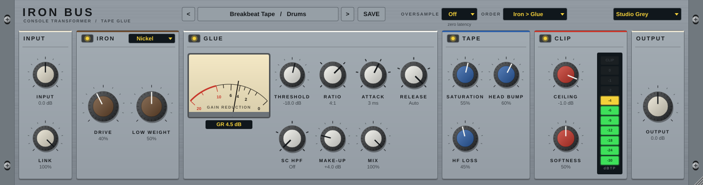
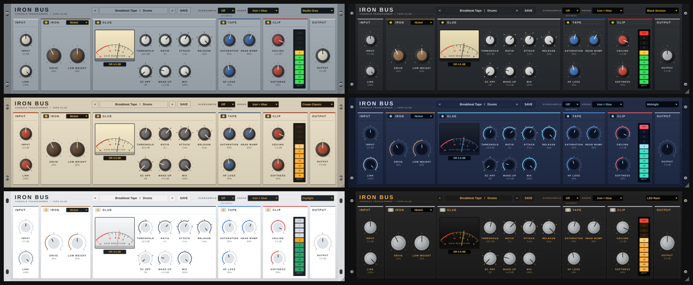

# Iron Bus (working name)

A console transformer and tape glue bus processor (VST3, AU on macOS, Standalone). One 1U strip with
transformer saturation, a VCA-style glue compressor with a sidechain high-pass, a light tape stage and
a soft clipper: the "finish" at the end of a mix. It pairs with Faderhouse's master inserts and uses
the same console themes. See [docs/DESIGN.md](docs/DESIGN.md).





## Controls

| Section | Controls |
|---|---|
| Input | Input gain, Stereo link (glue detector) |
| Iron | In/out, Type (Nickel / Steel / Clean), Drive, Low Weight |
| Glue | In/out, Threshold, Ratio (1.5 / 2 / 4 / 10), Attack (0.1 to 30 ms), Release (0.1 to 1.2 s or Auto), SC HPF (Off / 60 / 90 / 150 / 250 Hz), Make-up, Mix; gain-reduction VU |
| Tape | In/out, Saturation, Head Bump, HF Loss |
| Clip | In/out, Ceiling, Softness; true-peak style output LED ladder with a CLIP LED |
| Output | Output gain |
| Header | Presets (26 factory in 6 banks, plus user presets), Oversampling (Off / 2x / 4x), Order (Iron > Glue or Glue > Iron), Theme |

Oversampling defaults to **Off** (zero latency, for tracking). 2x adds 32 samples and 4x adds 48
samples of latency, which the plugin reports to the DAW. Double-click any knob to reset it.

## Installers (Mac and Windows)

Every push to GitHub builds both installers in GitHub Actions (`.github/workflows/build.yml`), after
the engine tests pass. Download them from the run's **Artifacts**, or push a tag like `v0.1.0` to
publish them on a Release page.

| File | Who it's for | What it installs |
|---|---|---|
| `IronBus-<ver>-macOS.pkg` | macOS 11+, Intel and Apple Silicon | VST3, AU, Standalone app |
| `IronBus-<ver>-Windows-Setup.exe` | Windows 10/11, 64-bit | VST3 into `C:\Program Files\Common Files\VST3`, Standalone app |

The builds aren't code-signed yet: on Mac right-click the .pkg and choose **Open**; on Windows click
**More info > Run anyway**.

## Build

```
cmake -B build -DCMAKE_BUILD_TYPE=Release            # fetches JUCE 8.0.4
# or: cmake -B build -DJUCE_DIR=/path/to/JUCE
cmake --build build --config Release
ctest --test-dir build -C Release --output-on-failure  # engine tests
```

macOS builds target macOS 11+ universal (Intel + Apple Silicon). No AVX2 or other `-march` flags
are used; the DSP is scalar C++. Windows builds use the static runtime. Linux needs
`libasound2-dev libx11-dev libxrandr-dev libxinerama-dev libxcursor-dev libfreetype-dev
libfontconfig1-dev libgl1-mesa-dev`.

`-DIRONBUS_BUILD_SNAPSHOTS=ON` builds `ironbus_snapshots <dir>`, which renders the editor in every
theme (`xvfb-run` on a headless Linux box).

## Layout

```
Source/engine   plain C++17, no JUCE: DSP blocks, oversampler, the four stages, parameter table, presets
Source/plugin   JUCE processor (parameters built from the engine's table), editor and themes
tests/          engine tests (run by ctest and in CI)
tools/          screenshot renderer
```
